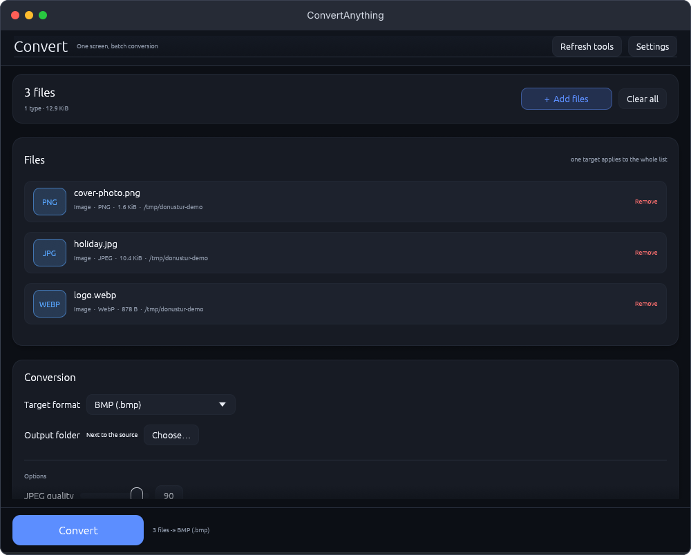

<h1 align="center">ConvertAnything</h1>

<p align="center">A batch file converter for Linux that handles images, audio, video, documents and archives from one screen.</p>

## Screenshots

<p align="center">
  
</p>

## Features

- Convert images, audio, video, documents and archives in one batch
- Target formats limited to those every selected file supports
- Direct conversion from the KDE Dolphin context menu without opening the app
- Turkish and English interface detected from the system locale
- Uses installed FFmpeg, LibreOffice and Pandoc engines; fully offline
- User-level AppImage installation with autostart at login

## Installation

Build and run from source:

```bash
git clone https://github.com/colgecen/ConvertAnything.git
cd ConvertAnything
./donustur --install
```

`--install` is a one-time step that lets you type `donustur` (no `./`) to open the build menu:

```bash
donustur
```

Prebuilt binaries are available on the [Releases](https://github.com/colgecen/ConvertAnything/releases) page.

## Usage

Run the app straight from source (press `Ctrl+C` to stop):

```bash
./donustur
```

Drag files into the window or use **Choose files...**, pick a target format, then press **Convert**. The interface follows the system language; output folder, parallel jobs and optional tools are configured in Settings.

Configuration lives in `~/.config/donustur/config.toml`.

## License

This project is licensed under the [MIT](LICENSE) license.
